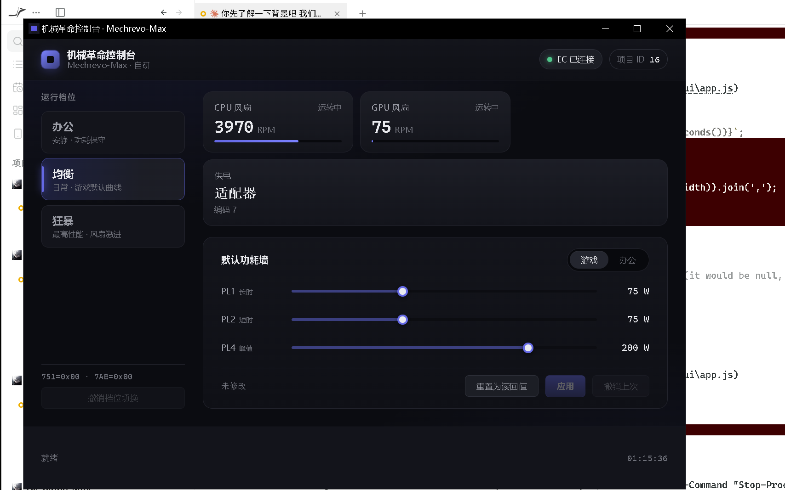

# Mechrevo-Max

机械革命（MECHREVO）笔记本的**自研控制台** —— 官方「电竞控制台」的轻量替代。
适用于机械革命 40 系列等采用同方（Uniwill）模具的机型。

## 为什么要重写

官方 ControlCenter3 的问题（均为本项目实测）：

| 问题 | 实测数据 |
|---|---|
| **内存占用巨大** | 主程序 137 MB + 托盘进程 41 MB = **178 MB** |
| **主程序无法反编译** | `GamingCenter3_Cross.dll` 是 .NET Native AOT，28.7 MB，无 IL |
| **进程间通信硬编码凭据** | 本地 MQTT `localhost:13688`，密码明文写死 `UWPClient_Pwd888881772688_10` |
| **通信链路静默失败** | 托盘进程用 `catch {}` 吞掉所有异常，MQTT 不通时用户完全无感知 |
| **装完 EC 通道不可用** | 驱动是 KMDF PnP 驱动（绑定 `ACPI\INOU0000`），但 Windows 不自动枚举该设备，官方安装流程也不触发扫描 → 驱动加载却无设备可绑 → **所有硬件功能失效** |
| **能力表数据不一致** | 官方能力表里 `LiquidCoolingAutoModeSupport=1` 却同时 `LiquidCoolingSupport=0` |

## 本项目做的

直接通过内核驱动访问 EC（Embedded Controller），**不依赖官方任何组件**。

### 已验证的能力（真机实测）

```
✅ EC 设备访问          \\.\ACPIDriver, IOCTL 0x9C40A488 / 0x9C40A48C
✅ 项目 ID 识别          读到 16，与官方注册表 ProjectID 一致
✅ 风扇转速              CPU 3970 RPM / GPU 75 RPM
✅ 电源状态              适配器/电池
✅ 功耗墙读取            Gaming 75/75/200, Office 45/45/200（与官方出厂值一致）
✅ 功耗墙写入            实测 45 → 50 生效 → 回滚 → 45 完全还原
✅ 运行档位切换          均衡/办公/狂暴三档，狂暴档 GPU 风扇 75→130 RPM 可见变化，实验后完全恢复
✅ 全量 EC 扫描          0x0000-0x0FFF 共 4096 地址，2002 个非零
```

### 安全设计（针对官方驱动的坑）

社区逆向发现官方驱动**存在把失败伪造成成功的代码路径**，`DeviceIoControl` 返回成功不代表硬件真的执行了。
本项目强制：

1. **失败必须报错** —— 绝不用 0 代替读失败
2. **写后读回校验** —— 默认写入方式
3. **改动前存回滚点** —— 任何写入前先 `snapshot`，失败自动回滚
4. **地址标注可信度** —— `Verified` / `CommunityUnverified` / `NotApplicable` 三态，不拿其他机型的地址当本机结论
5. **访问强制限速且不重叠** —— 整个 IOCTL 过程在**进程级**闸门内执行（默认 50 次/秒，硬下限 100 次/秒）：既保证间隔，也保证两次访问不重叠，新建 transport 实例也无法绕过
6. **回滚守卫** —— 会写硬件的代码路径持有 RAII 守卫，连 panic 展开都会还原（Rust 没有 `finally`）
7. **访问串行化** —— IPC 层用互斥锁保护 EC，忙时前端暂停轮询，避免并发读写交错

## 桌面应用

Tauri v2 桌面程序，界面用原生 HTML/CSS/JS（无打包器，构建链最短）。



功能：
- **分区工作台**：概览 / 系统监控 / 设备信息 / 电池 / 性能 / 风扇曲线 / 高级，共 7 页
- **实时读数**：CPU/GPU 温度与风扇（EC，2 秒）；CPU/内存、GPU 功耗/频率/显存、SSD 健康与电池状态（免驱采集）
- **运行档位**一键切换（办公 / 均衡 / 狂暴），带原始寄存器位域解释
- **默认功耗墙**调节：PL1 / PL2 / PL4；同时展示**只读固件基线**，不把默认值冒充系统实际生效值
- **强冷**、自定义配置（PL + 强冷）、寄存器只读浏览器与 CSV 导出、风扇曲线自动加载
- **风扇曲线写入**（v0.6.0）：CPU 曲线表（`0x0F00`/`0x0F20`）经行为级验证后开放写入；
  安全链 = 输入校验 + 地址白名单 + 写前快照 + RAII 自动回滚 + RPM 停转监视
- **一键撤销**：档位、功耗、强冷分别回到改动前快照
- 采样失败显示「无数据」，不把 `[N/A]`、缺字段或无电池伪造成 0；外部查询有 15 秒超时
- EC 不可用时给出修复指引，免驱 CPU/内存等数据仍展示；权限不足时可提权重启

### 风扇曲线边界

- **读取**：展示 EC `0x0F00–0x0F5F` 六个 16 字节块的候选曲线表；读取失败会退避，而不是每轮全量重试。
- **写入**：仅开放 CPU 表对（`0x0F00`/`0x0F20`）——已做行为级验证（占空比 -7% → RPM -7.1%，
  回滚逐字节复原，见 `evidence/fan-write-v2b.json`）；GPU 表对未验证，**不在写入白名单**。
- **回滚**：写入失败自动恢复写前快照；风扇转速跌破基线 30% 立即回滚；panic 也会恢复（RAII 守卫）。
- 官方 `UserFanTables` 数值仍未逐点核对（本机无该资源备份），但行为级验证已证明本区就是生效曲线。

### 构建

```bash
cd app/src-tauri
cargo tauri dev      # 开发运行
cargo tauri build    # 打包 msi / nsis
```

> ⚠️ **构建前必须把较新的 Windows SDK 加入 PATH**，否则 `embed-resource` 会选中
> 很旧的 `rc.exe`，在含中文的路径下编译资源失败：
> ```bash
> export PATH="/c/Program Files (x86)/Windows Kits/10/bin/10.0.26100.0/x64:$PATH"
> ```
>
> 另外：应用在启动时通过 `SetProcessDpiAwarenessContext` 声明 DPI 感知。
> 若缺少这一步，进程会被判定为 DPI 不感知，在 150% 缩放的屏幕上窗口被整体放大 1.5 倍，
> 物理尺寸超出屏幕导致右侧内容被裁掉。

## 结构

```
core/                   Rust 核心库 (mechrevo-core)
  src/ec/               EC 访问层（传输抽象 + Windows 实现 + Mock）
  src/control.rs        功耗墙控制（含回滚）
  src/mode.rs           运行档位切换（含回滚）
  src/sensors.rs        传感器读数
  src/namespace.rs      EC 寄存器地址表（带可信度标注）
  tests/hardware.rs     真机集成测试

app/                    桌面 GUI (Tauri v2)
  src-tauri/            后端：把 core 暴露为 IPC 命令
  ui/                   前端：原生 HTML/CSS/JS

tools/                  Python 逆向与分析工具
docs/protocol/          协议文档（ec-baseline.md = 入库的脱敏基线）
reverse/evidence/      逆向原始数据（含本机特征值 → 不入库）
workflow_status.md     工作状态台账
```

## 构建与测试

```bash
# 核心库（离线，用 Mock 传输层）
cd core
cargo test                                    # 单测 + doctest（数量随实现演进）
cargo clippy --all-targets -- -D warnings     # 0 warning
cargo test --test hardware -- --ignored --test-threads=1 --nocapture   # 真机测试（谨慎）

# 桌面应用
cd ../app/src-tauri
cargo test --bin mechrevo-max                 # IPC 层单测（锁/串行化/中毒处理）
cargo test --test ipc_contract                # 前后端契约（含解析 app.js 的 IPC 表）
cargo build --release
```

### 浏览器验收（不访问硬件）

需要本机已有 `playwright-core` 和 Chrome。脚本只打开独立 Chromium，IPC 使用 mock，**不是硬件 E2E**：

```bash
node tools/qa_browser.cjs
```

若 Playwright 装在别处，设置 `PLAYWRIGHT_MODULE` 为 `playwright-core` 的目录；
默认也会查找普通模块路径和本机已有的 `gsd-pi` 安装。断言和边界见 `docs/qa/ui-smoke-spec.md`。

### 前置条件：让 EC 设备就绪

```powershell
sc.exe start UWACPIDriver      # 启动内核驱动
pnputil.exe /scan-devices      # 触发 PnP 扫描（关键，官方漏了这步）
```

详见 [docs/protocol/ec-access.md](docs/protocol/ec-access.md)。

## 合规说明

本项目**不包含、不分发**任何官方二进制文件、驱动或反编译产物。
仓库内只有自研代码与协议分析结论；原始固件/驱动分析数据保留在使用者本机。

协议知识的来源是社区公开的逆向成果（LumaDesk、roj234/mechrevo_ec_api 等），
本项目在此基础上独立实现，并在真机上重新验证。

## 开发状态

见 [workflow_status.md](workflow_status.md)。

## 许可

MIT
